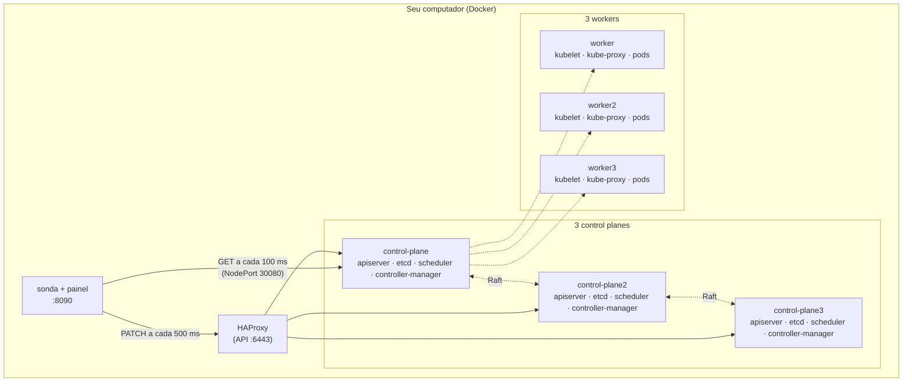

# Laboratório: Kubernetes como sistema distribuído

Um cluster Kubernetes de **6 nós** (3 control planes + 3 workers) rodando no seu
computador com [kind](https://kind.sigs.k8s.io/), uma aplicação de demonstração e uma
**sonda externa com painel ao vivo**. O objetivo é mostrar, com números, como o
Kubernetes mantém um serviço no ar quando pods, processos, nós e o próprio plano de
controle falham, e durante rollouts e rollbacks.

O que dá para demonstrar:

| # | Demo | Conceito de sistemas distribuídos | Resultado esperado na sonda |
|---|------|-----------------------------------|-----------------------------|
| 1 | [Reconciliação](demos/01-reconciliacao.sh) | laço de controle, estado desejado × atual | apagar/escalar pods: 0 falhas |
| 2 | [Probes](demos/02-probes.sh) | detecção de falhas (readiness × liveness) | segundos de erro só no pod que trava |
| 3 | [Rollout](demos/03-rollout.sh) | atualização sem parada | v1 → v2 com 0 falhas |
| 4 | [Rollback](demos/04-rollback.sh) | contenção de defeito, histórico de versões | v3 quebrada não derruba nada; `rollout undo` |
| 5 | [Sem probes](demos/05-sem-probes.sh) | contraste | erros no rollout e queda total com a v3 |
| 6 | [Falha de nó](demos/06-falha-de-no.sh) | detector de falhas por heartbeat/lease, timeouts | erros parciais por ~50 s, depois recupera |
| 7 | [Drain](demos/07-drain.sh) | manutenção planejada, PodDisruptionBudget | 0 falhas |
| 8 | [Scheduler](demos/08-scheduler.sh) | alocação de recursos (filtros e pontuação) | — |
| 9 | [Líderes](demos/09-lideres.sh) | eleição de líder com Lease | troca de líder em ~15–20 s |
| 10 | [etcd](demos/10-etcd.sh) | consenso Raft, quórum, CAP | API cai sem quórum; a aplicação continua no ar |

## Arquitetura



Cada nó é um contêiner Docker. A sonda roda **fora** do cluster e mede duas coisas:
o **plano de dados** (a aplicação responde?) e o **plano de controle** (a API aceita
escritas? toda escrita passa pelo consenso do etcd).

## Início rápido

Pré-requisitos: Docker, kind ≥ 0.31, kubectl, make, curl e cerca de 8 GB de RAM livres
([detalhes por sistema operacional](docs/01-preparacao.md)).

```bash
make up        # cria o cluster, constrói as imagens e implanta a aplicação (~5 min)
make probe     # em OUTRO terminal: sonda + painel em http://localhost:8090
make watch     # em um terceiro terminal (opcional): pods e nós ao vivo
./demos/03-rollout.sh
```

Depois de cada experimento, `make reset` desfaz as falhas injetadas e `make reset-app`
volta a aplicação para a v1. `make down` apaga tudo.

## Guia passo a passo

1. [Preparação do ambiente](docs/01-preparacao.md): instalar e verificar as ferramentas
2. [O cluster por dentro](docs/02-cluster.md): o que foi criado e como cada componente funciona
3. [Aplicação e sonda](docs/03-aplicacao-e-sonda.md): probes, imagens, implantação e painel
4. [Experimentos de alta disponibilidade](docs/04-alta-disponibilidade.md): demos 1 a 7
5. [Experimentos do plano de controle](docs/05-plano-de-controle.md): demos 8 a 10
6. [Métricas para o relatório](docs/06-metricas.md): como medir, repetir e analisar
7. [Roteiro da demonstração ao vivo](docs/07-roteiro-demo.md): 5 a 10 minutos de seminário
8. [Solução de problemas](docs/08-problemas.md)

## Estrutura do repositório

```
app/            código da aplicação (web) e da sonda (prober), em Go, e o Dockerfile
cluster/        configuração do kind: kind-ha.yaml (3+3 nós) e kind-lite.yaml (1+3)
k8s/            manifestos: Namespace, Deployment, Service, PodDisruptionBudget, RBAC da sonda
demos/          demos guiadas (explicam, executam e esperam Enter); 00-apresentacao.sh é o roteiro do seminário
chaos/          injeção de falhas: no.sh (nós), componente.sh (plano de controle), pod.sh
scripts/        criação do cluster, imagens, deploy, sonda, status, watch, repetição, carga, detecção
bench/          carga.js: teste de carga do k6 (vazão e latência)
analysis/       analisa.py: tabelas em Markdown e gráfico a partir do CSV da sonda
results/        CSVs e resumos gerados pela sonda (fora do git)
docs/           o guia passo a passo
```

## Como o laboratório atende ao enunciado

| Requisito | Onde |
|---|---|
| ≥ 3 nós/processos comunicando-se via rede | 6 nós (contêineres) na rede Docker `kind`; etcd com 3 membros em Raft |
| cenário de falha demonstrado | 10 demos: pod, processo, nó (travamento e partição), latência, líderes, etcd e quórum |
| comportamento do sistema diante da falha | sonda externa com painel, CSV, marcas de injeção e resumo automático |
| execução reprodutível | `make up` (cria tudo do zero, com versões fixadas: kind v0.31.0, Kubernetes v1.35.0) |
| métricas | disponibilidade, detecção, recuperação, latência p50/p95/p99 e vazão (k6): [docs/06-metricas.md](docs/06-metricas.md) |

> O enunciado pede "preferencialmente `docker compose up`". Um cluster kind é criado
> pelo próprio `kind` (que conversa com o Docker), por isso a entrada única aqui é
> `make up`.

## Plataformas

| Plataforma | Situação |
|---|---|
| Linux (x86_64/arm64) com Docker Engine | suportado (ambiente de referência) |
| macOS (Intel/Apple Silicon) com Docker Desktop, OrbStack ou Colima | suportado; `chaos/no.sh latency` depende do kernel da VM |
| Windows 10/11 com Docker Desktop + WSL2 | rode os comandos dentro do Ubuntu do WSL2 |
| Nuvem (uma VM Linux, ex.: EC2 com 2 vCPU e 8 GB) | mesmo procedimento do Linux; acesse o painel com `ssh -L 8090:localhost:8090` |

## Limitações

- **Todos os "nós" dividem a mesma máquina.** Uma falha real de hardware, de disco ou
  de energia não é simulada. Latência entre nós é de microssegundos, irrealista para
  o etcd em produção.
- **O nó `k8slab-control-plane` é a porta de entrada da sonda** (porta 8080 mapeada).
  Em produção, esse papel é de um balanceador externo apontando para todos os nós.
- Os tempos de detecção dependem de parâmetros (heartbeat do kubelet, grace period do
  node controller, `tolerationSeconds`). O manifesto usa `tolerationSeconds: 30` para
  caber na apresentação; o padrão é 300 s.
- A aplicação não tem estado. Aplicações com estado (bancos de dados, filas) precisam
  de StatefulSet, volumes replicados e um protocolo próprio de replicação.
