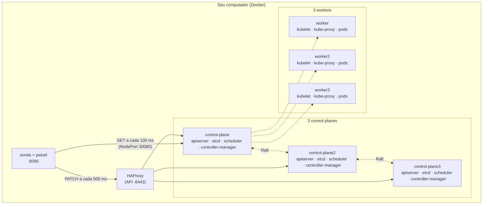

# Laboratório: Kubernetes como sistema distribuído

Um cluster Kubernetes de **6 nós** (3 control planes + 3 workers) rodando no seu
computador com [kind](https://kind.sigs.k8s.io/), uma aplicação de demonstração e uma
**sonda externa com painel ao vivo**. O objetivo é mostrar, com números, como o
Kubernetes mantém um serviço no ar quando pods, processos, nós e o próprio plano de
controle falham, e durante rollouts e rollbacks.

A apresentação (`demos/00-apresentacao.sh`, ~8 min) tem 5 passos:

| # | Passo | Conceito de sistemas distribuídos | Resultado esperado na sonda |
|---|-------|-----------------------------------|-----------------------------|
| 1 | O cluster | componentes do plano de controle, etcd, líderes | — |
| 2 | Rollout v1 → v2 | atualização sem parada (readiness probe) | 0 falhas |
| 3 | v3 com defeito e rollback | contenção de defeito, histórico de versões | v3 quebrada não derruba nada; `rollout undo` |
| 4 | Um worker cai | detector de falhas por heartbeat, timeouts | erros parciais, depois recupera |
| 5 | O etcd perde o quórum | consenso Raft, quórum, CAP | API cai; a aplicação continua no ar |

## Arquitetura



Cada nó é um contêiner Docker. A sonda roda **fora** do cluster e mede duas coisas:
o **plano de dados** (a aplicação responde?) e o **plano de controle** (a API aceita
escritas? toda escrita passa pelo consenso do etcd).

## Início rápido

Pré-requisitos: Docker, kind ≥ 0.31, kubectl, make, curl e cerca de 8 GB de RAM livres
([detalhes por sistema operacional](docs/01-preparacao.md)).

```bash
make up        # cria o cluster, constrói as imagens e implanta a aplicação (~5 min)
make probe     # em OUTRO terminal: sonda + painel em http://localhost:8090
scripts/deteccao.sh 20s   # opcional: detecta a queda de um nó em ~20 s em vez de ~50 s
make watch     # em um terceiro terminal (opcional): pods e nós ao vivo
./demos/00-apresentacao.sh
```

Para repetir a apresentação, `make reset-app` desfaz as falhas e volta a aplicação para
a v1. `make down` apaga tudo.

## Guia passo a passo

1. [Preparação do ambiente](docs/01-preparacao.md): instalar e verificar as ferramentas
2. [O cluster por dentro](docs/02-cluster.md): o que foi criado e como cada componente funciona
3. [Aplicação e sonda](docs/03-aplicacao-e-sonda.md): probes, imagens, implantação e painel
4. [Solução de problemas](docs/04-problemas.md)

## Estrutura do repositório

```
app/            código da aplicação (web) e da sonda (prober), em Go, e o Dockerfile
cluster/        configuração do kind (kind-ha.yaml: 3 control planes + 3 workers)
k8s/            manifestos: Namespace, Deployment, Service, PodDisruptionBudget, RBAC da sonda
demos/          00-apresentacao.sh, o roteiro da apresentação (explica, executa e espera Enter)
chaos/          injeção de falhas: no.sh (nós), componente.sh (etcd), restaura.sh
scripts/        criação do cluster, imagens, deploy, sonda, status, watch, detecção
results/        CSVs e resumos gerados pela sonda (fora do git)
docs/           o guia passo a passo
```

## Como o laboratório atende ao enunciado

| Requisito | Onde |
|---|---|
| ≥ 3 nós/processos comunicando-se via rede | 6 nós (contêineres) na rede Docker `kind`; etcd com 3 membros em Raft |
| cenário de falha demonstrado | rollout com versão defeituosa, queda de nó e perda de quórum do etcd |
| comportamento do sistema diante da falha | sonda externa com painel, CSV, marcas de injeção e resumo automático |
| execução reprodutível | `make up` (cria tudo do zero, com versões fixadas: kind v0.31.0, Kubernetes v1.35.0) |
| métricas | disponibilidade da aplicação e da API, versão que respondeu, incidentes e duração, no painel e no CSV da sonda |

> O enunciado pede "preferencialmente `docker compose up`". Um cluster kind é criado
> pelo próprio `kind` (que conversa com o Docker), por isso a entrada única aqui é
> `make up`.

## Plataformas

| Plataforma | Situação |
|---|---|
| Linux (x86_64/arm64) com Docker Engine | suportado (ambiente de referência) |
| macOS (Intel/Apple Silicon) com Docker Desktop, OrbStack ou Colima | suportado |
| Windows 10/11 com Docker Desktop + WSL2 | rode os comandos dentro do Ubuntu do WSL2 |

## Limitações

- **Todos os "nós" dividem a mesma máquina.** Uma falha real de hardware, de disco ou
  de energia não é simulada. Latência entre nós é de microssegundos, irrealista para
  o etcd em produção.
- **O nó `k8slab-control-plane` é a porta de entrada da sonda** (porta 8080 mapeada).
  Em produção, esse papel é de um balanceador externo apontando para todos os nós.
- Os tempos de detecção dependem de parâmetros (heartbeat do kubelet, grace period do
  node controller, `tolerationSeconds`). O manifesto usa `tolerationSeconds: 30` para
  caber na apresentação; o padrão é 300 s.
- A aplicação não tem estado. Aplicações com estado (bancos de dados, filas) precisam
  de StatefulSet, volumes replicados e um protocolo próprio de replicação.
